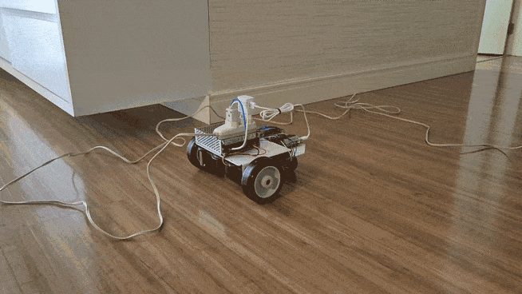
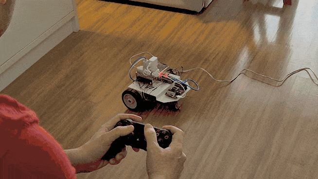

# Brutusbot

Brutusbot is a hands-on ROS 2 differential-drive robot project that connects
robot modelling, simulation, low-level control, and physical hardware in one
small mobile platform. A Raspberry Pi 5 runs ROS 2 and the `ros2_control`
stack (the ROS 2 control stack), while an Arduino controls the motor drivers
for two stepper motors.
The same robot description and controller configuration support both Gazebo
simulation and the real robot, keeping the path from virtual testing to
hardware deliberately close.

The project includes a Xacro/URDF model of a two-wheel-and-caster base, RViz
visualisation, Gazebo simulation through `gz_ros2_control`, and a
`diff_drive_controller` with joint-state publishing, odometry/TF, velocity
limits, and joystick teleoperation. For the physical robot, a custom ROS 2
hardware-interface plugin translates wheel commands from radians per second to
the Arduino's degree-based stepper commands, and converts the reported motor
state back into ROS 2 joint states.

## Serial protocol

The Raspberry Pi and Arduino communicate at 115200 baud through a small,
bounded binary framing protocol. Each frame contains a `0x7E` start byte, a
payload length and its consistency byte, a payload made of a message code plus
data, and a final 8-bit additive checksum over the length and payload. A
byte-by-byte state-machine parser enforces the payload limit, rejects malformed
or corrupted frames, and resets so it can resynchronise on the next frame.

The protocol supports a wheel-velocity command carrying left and right
32-bit-float values, an acknowledgement reply, a state request, and a state
reply with the left/right stepper positions and velocities. The ROS 2 hardware
interface also treats timeouts, malformed replies, and unexpected messages as
communication errors, escalating only after consecutive failures; startup
retries the initial state request before activating the robot.

## Roadmap

The next hardware milestone is replacing the current AC supply with onboard
battery power, followed by an IMU, LiDAR, and camera. Those sensors will enable
sensor fusion, SLAM, and Nav2-based autonomous navigation as Brutusbot evolves
from a teleoperated base into a self-navigating robot.
